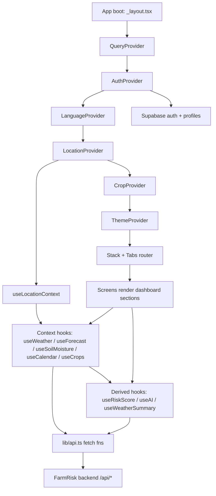

# 10 — End-to-End Data Flow

This is the "how it works" document: how a user action or app boot turns into API calls, cached state, and rendered UI. It ties together everything from `01`–`09`.

---

## The big picture



Rules of thumb:

1. **Location is the root dependency.** Every data hook waits on `useLocationContext().location` before firing its query.
2. **Hooks wrap TanStack Query.** Screens never call `fetch` directly — they call hooks from `hooks/` (or `useLocationContext`).
3. **`lib/api.ts` is the only HTTP layer.** All requests go to one backend (`EXPO_PUBLIC_API_URL` or `https://farmrisk.vercel.app`).
4. **Data flows down via context, up via query keys.** Context provides location/language/auth/crop; query keys make the cache invalidate correctly.

---

## 1. App boot sequence

1. `app/_layout.tsx` mounts providers in order: `QueryProvider` → `PaperProvider` → `AuthProvider` → `LanguageProvider` → `LocationProvider` → `CropProvider` → `ThemeProvider` → `<Stack>`.
2. `LanguageProvider` loads the saved language from AsyncStorage (`farmrisk-language`) and renders `null` until loaded (avoids flashing wrong-language UI).
3. `LocationProvider` runs its init effect (`initLocation`).

### Location resolution lifecycle (`LocationProvider`)

The init strategy is **stored → recents → GPS**:

1. **Stored active location** — reads `farmrisk:active_location` (JSON `{lat, lng, name, displayName}`). If valid (`lat && lng`), use it immediately.
2. **Most recent from recents** — reads `farmrisk:recent_locations` (array; index 0 = most recent). If present and valid, use `recents[0]` and persist it as active.
3. **GPS fallback** — `requestCurrentLocation()`:
   - `expo-location`: `requestForegroundPermissionsAsync()` → if granted, `getCurrentPositionAsync({ accuracy: Balanced })`.
   - Web fallback: `navigator.geolocation.getCurrentPosition` (10s timeout).
   - Reverse-geocode the coordinates through `reverseGeocode(lat, lng)` (`/api/locations?mode=reverse`) to get `display_name` and a short `name` (district → state → first comma part → `"My Location"`).
   - Persist via `setLocation`.

`setLocation(newLoc)`:
- Updates state, clears `locationError`.
- Writes `farmrisk:active_location` to AsyncStorage (fire-and-forget, `.catch(console.warn)`).

While resolving, `isResolving = true`. If everything fails, `locationError = true` and `location` stays `null`.

`retryLocationInit()` bumps an internal `initTrigger` state which re-runs the whole init effect (used by the `LocationRequired` retry button).

### Location-required screen

Every tab screen starts with:

```tsx
if (!location && !isResolving && locationError) {
  return <LocationRequired />;   // "allow location" + retry CTA
}
```

So when GPS fails and nothing is stored, the user sees `components/LocationRequired.tsx` (prompts permission + `retryLocationInit`) instead of an empty dashboard.

---

## 2. Query layer (TanStack Query)

### Query keys (the cache contract)

| Query | Key |
|---|---|
| Weather | `["weather", lat, lng]` |
| Forecast | `["forecast", lat, lng]` |
| Soil moisture | `["soil-moisture", lat, lng, crop, daysbefore]` |
| Crops | `["crops", lat, lng]` |
| Calendar | `["calendar", crop, lat, lng]` |
| AI advisory | `["ai", lat, lng, crop, language, forecastHash]` |
| Weather summary | `["weather-summary", ...]` |
| Risk score | `["riskScore", lat, lng, payloadHash]` |
| Location search | `["location-search", q]` |

Key rules:

- **Keys include coordinates** → switching villages creates distinct cache entries (and old ones are retained until evicted).
- **AI + risk keys include content hashes** (`forecastHash`, `payloadHash`) so cached results automatically invalidate when the underlying forecast data changes.
- Context hooks set `staleTime: 60 * 60 * 1000` (1 hour).

### The context-hook contract

Context hooks (`useWeather`, `useForecast`, `useSoilMoisture`, `useCrops`, `useCalendar`) share a return shape:

```ts
{ data, isLoading, isFetching, isError, error, refetch }
```

where `isLoading = isResolving || !location || query.isLoading` — i.e. "loading" also covers the location-resolution phase.

---

## 3. Data path per domain

### Weather (current + hourly + daily)

1. `LocationProvider` resolves `location`.
2. `useWeather()` fires `getWeather(lat, lng)` → `GET /api/weather`.
3. Returns `OpenMeteoResponse` with localized `current.condition`, `hourly.icon[]`, `daily` arrays, and `lightning`.
4. Consumed by `CurrentWeatherSection` (current tile + stats), `HourlyWeatherSection` (24h strip), `ForecastSection` (16-day), `LightningRiskSection` (score/category), and `useRiskScore` (humidity/wind/gusts/lightning inputs).

### Forecast (bias-corrected rows)

1. `useForecast()` fires `getForecast(lat, lon)` → `GET /api/forecast`.
2. It derives `forecastRows` from the response; if the API has no rows it **falls back to Open-Meteo `daily`** arrays so the UI never sits empty.
3. `isError` is only true when the request failed **and** no fallback data exists.
4. `forecastRows` feed: `ForecastSection`, `useRiskScore` (next-5-day rain/temp), `useAI`/`useWeatherSummary` (village report + hash), `SoilMoistureSection` context.

### Soil moisture

1. `useSoilMoisture(crop?, daysbefore?)` — `activeCrop = crop && crop !== "general" ? crop : undefined`.
2. Fires `getSoilMoisture(lat, lon, activeCrop, daysbefore)` → `GET /api/soil-moisture`.
3. **Internally also calls `useForecast()`** (soil moisture UI overlays forecast rows).
4. Returns `soilMoistureRows` with `w` (active storage mm) and `sm_percentile` — mapped to the wet/dry band labels (`smExceptionalWet` … `smExceptionalDry`) in `SoilMoistureSection`.
5. `useRiskScore` reads the latest row's `sm_percentile` into its payload.

### Crops & calendar

1. `useCrops(lat, lng)` → `GET /api/crops`; used by the crop picker (Profile screen).
2. `useCalendar(crop, lat, lng)` → `GET /api/calender` (misspelled, intentional). Used by `CropCalendarSection` (12-month phase bars) and by `useAI` (calendar context for advisories).

### Risk score

1. `useRiskScore()` pulls `useWeather()`, `useForecast()`, `useSoilMoisture("general")` **and** `useLocationContext()` — it is a *derived* hook that consumes three others.
2. `buildPayload()` computes client-side hazard features:
   - From next-5 `forecastRows`: `rain_next5`, `rain_dates`, `max_daily_rain`, `total_rainfall`, `rainy_days` (pcp > 1mm), `max_temp`, `avg_max_temp`, `min_temp`, `avg_min_temp`.
   - From `weatherData.current`: `humidity`, `wind_speed`, `wind_gusts`, `lightning_score`.
   - From `weatherData.hourly`: `gusts_hourly`, `times_hourly` (first 24).
   - From latest soil moisture row: `soil_percentile`, `soil_moisture_available`.
3. POSTs to `/api/risk` (query key includes `JSON.stringify(payload)` as the hash).
4. Response shape per hazard (`overall`, `heavy_rain`, `heat_stress`, `pest`, `lightning`, `wind`, `frost`): `{ score, band, major_factor, reasons }`. `RiskSection` renders severity bands; `LightningRiskSection` uses the lightning-specific data.

### AI advisory (the village report)

This is the most important derived flow — see §4 below.

---

## 4. The village report (AI payload assembly)

`useAI(cropId?, language = "en")` (used by `AIAdvisorySection`, which currently passes `"en"`) assembles the exact `VillageReportAPIResponse` contract from `types/forecast.ts`:

1. Pulls `useCalendar(activeCrop)`, `useWeather()`, `useForecast()`, `useSoilMoisture(activeCrop)` where `activeCrop = cropId || "general"`.
2. Builds `villageReport` **only when `forecastRows.length > 0 && location`**:

```ts
{
  requested_lat, requested_lon,
  village_id: 12345,                       // hardcoded placeholder
  forecast: {
    success: true,
    location: { lat, lon, elevation_m: weatherData?.elevation || 0 },
    grids_used: [],
    forecast_source: "bias-corrected",
    forecast: forecastRows.map(row => ({
      date, tmax_raw, tmax_corrected, tmin_raw, tmin_corrected, pcp_raw, pcp_corrected,
    })),                                    // falls back raw ↔ corrected per field
    runtime_seconds: 0,
  },
  soil_moisture: {
    success: true,
    location: { lat, lon },
    cold_start: false,
    days_computed: soilMoistureResponse?.soil_moisture?.length || 0,
    checkpoint_last_date: "",
    soil_moisture: rows.map(row => ({ date, P_obs, Tmean, PE, P_eff, snowpack, w, E, R, G, w_frac, sm_percentile, is_forecast })),
    runtime_seconds: 0,
  },
  cache_hit: false,
  total_runtime_seconds: 0,
  cache_key: null,
}
```

3. Computes `forecastHash = forecastRows.map(d => `${d.date}:${d.pcp_corrected}`).join(",")` — this is baked into the query key so any forecast change re-fetches the advisory.
4. The **automatic query** POSTs `{ location, cropId, calendarData, weatherData, forecastData: villageReport, language }` to `/api/ai`. Enabled only when calendar, weather, forecast, and location are all ready.
5. The **ask mutation** (`askAdvisory(userQuery)`) POSTs the same payload plus `query: userQuery` — powers the "ask a follow-up" input.
6. Returns `{ data: advisory_summary, sources, isLoading, isError, error, askAdvisory, refetch }`. `AIAdvisorySection` renders `data` (markdown-ish: `**bold**`, `*italic*` highlight rendering) plus a sources modal.

`useWeatherSummary(language?)` (used by `CurrentWeatherSection`) follows the same assembly pattern but POSTs to `/api/ai/weather-summary` for the short "AI overview" blurb.

---

## 5. Screen-by-screen flows

### Home tab — `app/(tabs)/index.tsx`

1. Reads `useRefreshDashboard()` (pull-to-refresh) + `useLocationContext()`.
2. Guards: `!location && !isResolving && locationError` → `<LocationRequired/>`.
3. Renders `ScrollView` sections in order:
   - `Header` — auth state from `useAuth`; router for profile.
   - `SearchSection` — current location chip → navigates to `search.tsx`.
   - `CurrentWeatherSection` — `useWeather()` + `useWeatherSummary()`.
   - `RiskSection` — `useRiskScore()`.
   - `HourlyWeatherSection` — `useWeather().data.hourly`.
   - `ForecastSection` — `useForecast()` rows.
   - `SoilMoistureSection` — `useSoilMoisture()` (no crop → general).
   - `AIAdvisorySection crop={selectedCrop}` — local state `selectedCrop` is `useState("")` and never changed on this screen, so `useAI` treats it as `"general"`.

### Forecast tab — `app/(tabs)/forecast.tsx`

Same guard + refresh pattern, then:

- `HourlyWeatherSection` → 24h strip.
- `ForecastSection` → 16-day rows.
- `SoilMoistureSection crop={selectedCrop}` — crop from `useCropContext()`.
- `CropCalendarSection crop={selectedCrop}` — `useCalendar(activeCrop)`.

### Tools tab — `app/(tabs)/tools.tsx`

- `AIAdvisorySection crop={selectedCrop}` (from `useCropContext()`) — the RAG advisory tool.
- Static "Smart Field Utilities" card (Irrigation Tool, Sowing Planner placeholders — not functional).

### Alerts tab — `app/(tabs)/alerts.tsx`

- `LightningRiskSection` — `useWeather()` lightning score/category + advisory.
- Static "Active Weather Hazards" card (Heavy Rainfall / Heatwave / Frost rows with hardcoded "Normal/Low Risk/None" badges — placeholders, not wired to data).

### `app/search.tsx` — village search

- `useLocationSearch(q)` → `searchLocations(q)` → `/api/locations?mode=search` (query key `["location-search", q]`).
- Selecting a result calls `setLocation(...)` (persists active location) and navigates back — the whole dashboard re-queries because query keys include the new coordinates.
- "Use my location" triggers `requestCurrentLocation()`; "Select from map" → `app/map.tsx`.

### `app/map.tsx` — Leaflet map picker

- `LeafletMapView` (WebView) shows the interactive map; taps are reverse-geocoded → location selected → `setLocation`.

### `app/profile.tsx` — profile + crop picker

- Auth flows via `useAuth()` (Supabase; phone `normalizePhoneNumber` → `<phone>@farmrisk.app`).
- Reads/writes `profiles` table (Supabase) — name/age/location fields.
- Crop picker calls `useCrops(lat, lng)` and `useCropContext().setSelectedCrop(...)`; the selected crop is persisted (`farmrisk_selected_crop`) and consumed by the Forecast/Tools tabs.

### `app/weather-table.tsx` & `app/soil-detail.tsx`

- Detail/deep-link screens rendering the same hooks (`useForecast`, `useSoilMoisture`). `soil-detail.tsx` is not linked from any screen (deep-link only); `DownloadButton` (CSV export) is not wired.

---

## 6. Pull-to-refresh (`useRefreshDashboard`)

Every tab's `ScrollView` has a `RefreshControl`:

```ts
{ refreshing, onRefresh } = useRefreshDashboard();
<RefreshControl refreshing={refreshing} onRefresh={onRefresh} colors={["#007a55"]} tintColor="#007a55" />
```

Behavior:

1. Sets `refreshing = true`.
2. **10-second spam cooldown:** if the user pulls again within 10s, it just clears the spinner after 400ms and returns — no API spam.
3. Otherwise records the timestamp and calls `queryClient.invalidateQueries()` — **all** queries refetch (stale data replaced), while `location` context is untouched.
4. Spinner clears in `finally`.

---

## 7. Error & empty states

| Scenario | What the user sees |
|---|---|
| Location resolving | Sections render their loading skeletons/spinners (`isLoading` includes `isResolving`) |
| Location failed entirely | `<LocationRequired/>` on all tabs (permission prompt + retry) |
| Weather fetch fails | `CurrentWeatherSection` shows `weatherLoadError` / `weatherLoadErrorDesc` strings + retry |
| Forecast fails, no fallback | Forecast UI error state (`isError` true) |
| Forecast fails, Open-Meteo fallback exists | Fallback rows render (no error shown) |
| AI advisory fails | `AIAdvisorySection` shows `advisoryError` string; `askAdvisory` mutation has its own error handling |
| Risk fetch fails | `RiskSection` shows `fetchRiskError` |
| No data at all | `noData` string used by sections |

---

## 8. Persistence map (AsyncStorage)

| Key | Written by | Contents |
|---|---|---|
| `farmrisk-language` | `LanguageProvider` | `"en" \| "hi" \| "mr" \| "ta" \| "gu"` |
| `farmrisk:active_location` | `LocationProvider.setLocation` | `SelectedLocation` JSON |
| `farmrisk:recent_locations` | location search flow | Array of `SelectedLocation` (index 0 = most recent) |
| `farmrisk_selected_crop` | `CropProvider` | Selected crop id |

Supabase also persists its auth session via the custom AsyncStorage wrapper (keys are Supabase-managed).

---

## 9. Change checklist (what to touch when...)

- **Add a new backend endpoint** → add a function in `lib/api.ts`, add types in `types/`, add a query hook in `hooks/` (context- or param-based), consume it in a section component.
- **Add a new dashboard section** → new file in `components/dashboard/`, export from `components/dashboard/index.ts`, render it in the desired tab screen.
- **Add a new tab** → new file in `app/(tabs)/`, register in `app/(tabs)/_layout.tsx` (`Tabs.Screen` + icon).
- **Wire a new language** → `constants/languages/xx.ts` + register in `constants/content.ts`.
- **Change when data refreshes** → adjust `staleTime`/`refetchInterval` on the hook's `useQuery` options (not in `lib/api.ts`).
- **Change what triggers a refresh** → the query key (include whatever data affects the result, e.g. `forecastHash`).
